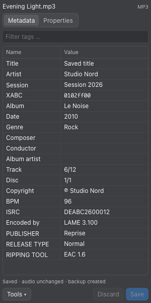

# Advanced Audiotags for Eagle

An offline audio metadata editor in Eagle’s **right-hand inspector**. Browse embedded tags, rename custom fields, edit values and inspect the actual audio encoding. Eagle’s own library tags remain separate from embedded audio metadata.

The compact Name/Value table follows foobar2000’s properties layout while using Eagle’s fonts, colors, selection styles and all six native themes. Eagle’s resolved inspector theme takes precedence at startup; Auto follows Eagle’s gray/light behavior.



## Install

1. Use Eagle 4 with the `item.replaceFile()` plugin API.
2. Download **Advanced.Audiotags.eagleplugin** from [Releases](https://github.com/kpaede/Advanced-Audiotags-for-Eagle/releases/latest) and open it in Eagle.
3. Select one supported audio file. Expand **Advanced Audiotags** in the right-hand inspector. Reload an existing development installation after updating.

No FFmpeg installation, npm installation or internet connection is required to use the plugin. The libraries and WebAssembly binary are included. The plugin registers inspector associations; Eagle must also be able to import the file. It does not add columns to Eagle’s central list or grid.

## Formats

Extensions identify candidate files; the parsers also inspect their content. A container and its audio codec are different things: M4A can contain AAC or ALAC, WAV can contain several encodings, and Ogg can contain Vorbis, Opus, FLAC or Speex.

| Audio family | Extensions | Metadata and current behavior |
| --- | --- | --- |
| MPEG audio | mp3, mp2, mp1, m2a | ID3v2.2/2.3/2.4, ID3v1/1.1, Enhanced TAG+ and trailing APE tags; editable raw frames and custom descriptions |
| Raw AAC | aac | ADTS audio with ID3/APE metadata; player support for descriptive tags varies |
| Dolby audio | ac3, eac3, ec3 | Existing ID3/APE metadata and new leading ID3v2.4; many raw Dolby players ignore or reject these tags |
| FLAC | flac | Native Vorbis Comments, pictures and raw metadata blocks; structural blocks protected |
| Ogg | ogg, oga, opus, spx | Vorbis, Opus, Ogg FLAC and Speex comments; custom names editable |
| RIFF/WAVE | wav, wave, bwf | Mapped text metadata editable; native ID3/RIFF records inspectable in Properties |
| AIFF | aif, aiff, aifc | Mapped text metadata editable; native records inspectable |
| MP4 audio | m4a, m4b, m4r, m4p, mp4, alac, 3gp | AAC/ALAC and other recognized codecs; mapped standard/freeform properties; existing DRM is not removed |
| Windows Media | wma, asf | Native ASF Content Description and Extended Content Description Unicode attributes editable; custom names editable; typed/binary attributes preserved and read-only |
| Monkey’s Audio | ape | APE properties and custom names editable |
| WavPack | wv, wvp | APE properties and custom names editable |
| Musepack | mpc, mpp, mp+ | APE properties and custom names editable |
| TrueAudio | tta | Mapped ID3 properties and custom names editable |
| DSD | dsf, dff | Mapped metadata editable; DSD sample precision and sample rate displayed |
| Matroska/WebM | mka, mkv, webm | Mapped metadata editable where supported; native records inspectable; audio tracks remain encoded |
| Core Audio / Shorten | caf, caff, shn | Inspection only with the bundled writer; explicitly read-only |

The automated real-file suite exercises 19 generated encoding/container variants. Additional upstream references cover Monkey’s Audio, Musepack, DSF and DFF. Extension aliases, every codec inside each container, damaged variants and protected commercial files have not all been independently tested. Unsupported or unverifiable writes are blocked. This is not a claim that every metadata structure has a dedicated editor.

## Edit metadata

- Edit a value directly in the **Value** column. Multi-line values expand on focus.
- Edit a custom name directly in the **Name** column and press Enter or leave the field. In ID3, this changes the description of `TXXX`/`WXXX` (or v2.2 equivalents), while retaining the frame type. Standard frame identifiers have fixed meanings.
- **Tools → + Tag** adds a standard or custom field. Friendly names such as `TITLE` choose the correct frame for the existing ID3 version. An arbitrary ID3 name becomes a user-defined text field. Select a target when several tag containers exist.
- Right-click a row or select it and open **Tools** for removal, export, descriptions, language and cover actions.
- **Edit hex** exposes the payload of an eligible binary-codec field. Unsupported compressed/encrypted/grouped frames and protected structures are read-only. Unchanged bytes are preserved.
- `␀` represents a NUL character. It can separate ID3v2.4 text values and APE values. It is not a universal list separator. Mapped multi-values are written only if the container preserves them; ASF Unicode values cannot contain NUL.
- **Save** or **⌘S / Ctrl+S** writes changes. **Discard** resets the draft; **Reload** reads the file and restores a matching cached draft.

Names are displayed literally. The plugin does not invent `<ANGLE BRACKETS>` around unknown fields. If a name actually contains brackets, they remain part of its stored name.

Cover addition/replacement is available for the binary ID3/FLAC backend, Ogg Vorbis and MP4. The bundled generic writer does not expose cover editing for every other format; existing pictures are preserved. MP4 cover addition accepts PNG/JPEG. Extra native records can be expanded in **Properties**; binary payloads there are summarized rather than expanded into enormous JSON arrays.

## Audio properties

Properties include container, codec, profile, lossless/lossy encoding, bitrate, CBR/VBR/ABR when reliably available, sample rate, channels/layout, sample precision, duration, sample count, encoder and file size. Codec-defined values take precedence. Lossy sample precision is not presented as an original recording bit depth. Missing facts are explicitly labeled unknown/not reported.

MP3 mode is derived from MPEG frames and Xing/Info/VBRI/LAME information. AC3/E-AC3 properties are read from bitstream frames. MP4 AAC channels are checked against AudioSpecificConfig. When an exact stream bitrate is unavailable, a file-size estimate is explicitly labeled as including container and metadata overhead. Variable lossless compression is distinguished from uncompressed PCM/DSD.

## Backups and limits

Saving prepares and parses a replacement first, checks the encoded audio payload against its original SHA-256 digest, and verifies requested mapped values and supported cover images. Only then is the previous file backed up and the replacement passed to Eagle. The source is checked for concurrent external changes. Audio is not re-encoded, and Eagle’s library database is not edited directly.

Backups are kept in **Advanced Audiotags Backups** in Eagle’s application data. Open the directory through **Tools → Help & backups → Open backup folder**. **Tools → Backup** restores the latest backup and also backs up the current version. Backups remain until you remove them.

Files are loaded into memory; the current limit is **512 MB**. Drafts are stored locally per file. Very large image drafts may exceed browser storage; the inspector reports this. Save before switching files if that occurs.

The binary ID3/FLAC backend preserves unsupported payloads and separate tag versions. The generic TagLib backend maps text properties and can normalize tag representation when writing; it does not promise byte-for-byte metadata preservation. Extended ID3 restrictions and unknown structures may make a section read-only. Leading APE, Lyrics3 and appended ID3 without a footer are not independently modeled. See the [standards audit](docs/STANDARDS-AUDIT.md) for decisions and remaining limitations.

## Renderer compatibility

Version 1.1.1 fixes a startup failure in 1.1.0: Eagle’s renderer cannot create Node Worker threads, even though Workers run in the standalone Node mode of the same executable. The inspector now obtains the main executable through `eagle.app.getPath('exe')` and starts its metadata subprocess with `ELECTRON_RUN_AS_NODE=1`. JSON IPC preserves shared metadata entries and binary buffers without Electron 22’s advanced-serialization failure. The subprocess closes on inspector unload and after an idle timeout.

## Development and verification

Use Node.js **22.6 or newer** to build/install dependencies. The distributed CommonJS bundles target **Node 16**, and buffer-based reads/writes have also been checked in Eagle’s embedded Node 16.17.1 runtime. No native Node add-on is required. Parsing and WebAssembly run in a separate Node process using Eagle’s executable so the inspector retains its strict Content Security Policy and remains responsive.

```sh
npm ci --ignore-scripts
npm run build
npm run check
npm test
npm run package
```

To run the independent encoding/decoding suite, provide FFmpeg and FFprobe:

```sh
FFMPEG_PATH=/path/to/ffmpeg FFPROBE_PATH=/path/to/ffprobe npm test
```

`node scripts/ui-smoke.cjs` checks the actual inspector in headless Chrome with mocked Eagle file APIs: compact rows, English controls, custom-name drafts, save, sidebar width and all native themes. It uses the macOS Eagle/Chrome installation by default; override `EAGLE_ASAR` and `CHROME_PATH` as needed. A browser mock does not replace a final manual test inside Eagle.

For the additional upstream reference-file tests, set `TAGLIB_TEST_DATA` to the `tests/data` directory in the corresponding TagLib source archive. `scripts/eagle-runtime-smoke.cjs` performs buffer-based read/write checks using the same optional reference directory and generated fixtures. See [validation](docs/VALIDATION.md).

`npm run test:renderer` runs the actual inspector in an isolated Electron renderer, with the real file store and Eagle backend subprocess. Set `ELECTRON_TEST_PATH` to an Electron executable, `AUDIO_TEST_FIXTURES` to generated fixtures, and optionally `EAGLE_EXEC_PATH` to Eagle’s main executable. This test reproduces the Worker limitation and checks real FLAC/Ogg/M4A saves through the UI.

## Third-party software

This distribution includes TagLib-Wasm, TagLib, music-metadata and their dependencies. Their notices and licenses are shipped with the plugin; see [THIRD-PARTY-NOTICES.md](THIRD-PARTY-NOTICES.md). The release provides the corresponding TagLib-Wasm/TagLib source archive, including build scripts and pinned submodules. The WebAssembly library can be rebuilt and replaced independently.
